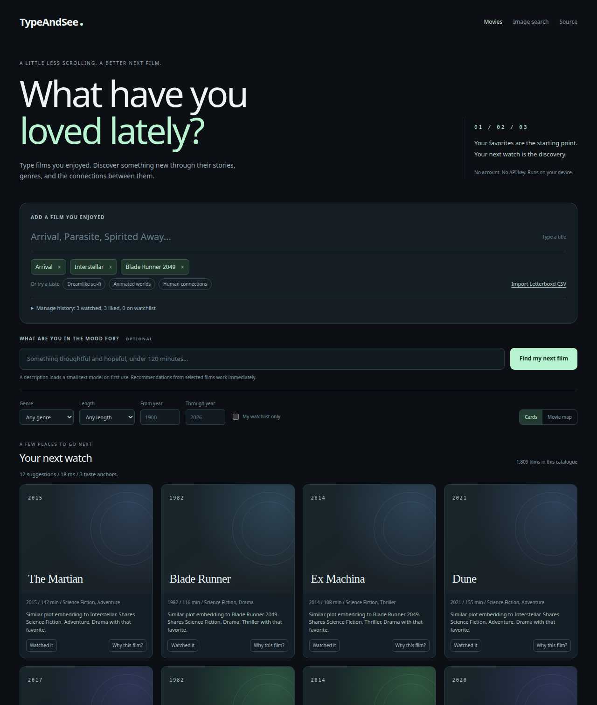
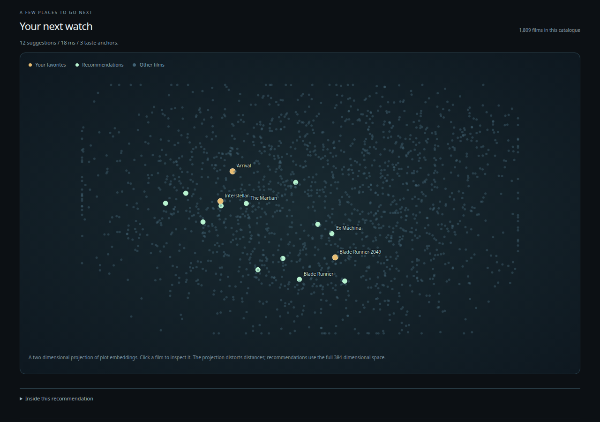

# TypeAndSee

**Type films you loved. Find your next watch.**

[Open TypeAndSee](https://tientnc.github.io/TypeAndSee/)



*Your favorites lead to unseen films through plot embeddings, genres, directors, and a diversity pass.*



*Explore 1,809 films in an interactive projection. Open a film for matching evidence and source records.*

Import a Letterboxd CSV, manage watched films, or add a mood and runtime limit. Source-linked matching evidence explains each recommendation. Film history stays in your browser. No account or API key is needed.

```bash
python3 -m http.server 8000 --directory web
```

Open [localhost:8000](http://localhost:8000). [Movie app and evaluation](docs/movie-discovery.md) | [Data credits](catalogue/README.md)

The original [image search demo](https://tientnc.github.io/TypeAndSee/web/images/) and [Python image API](docs/guide.md) are also available.
