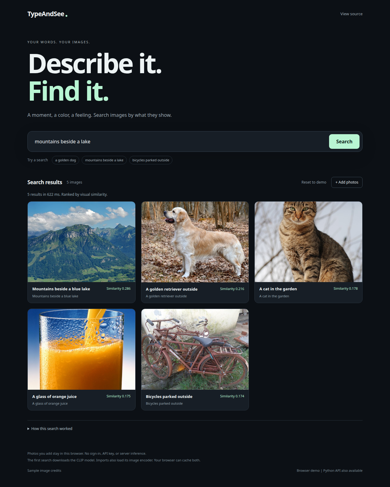

# TypeAndSee

Search photos with a description, such as **"a red bicycle beside a café"**.

[Open the browser demo](https://tientnc.github.io/TypeAndSee/). Search runs on your device, with no account or API key.



*Live browser search. [Sample image credits](web/credits.html).*


*Browser demo: CLIP and Orama. Python API: CLIP with Chroma or Firestore, plus optional grounded explanations.*

```bash
uv sync --extra test
uv run uvicorn typeandsee.api:app --reload
```

Open [localhost:8000](http://localhost:8000). See the [Python app guide](docs/guide.md) for imports, evaluation, and tracing, or the [browser demo guide](docs/browser-demo.md) for the free static deployment.
