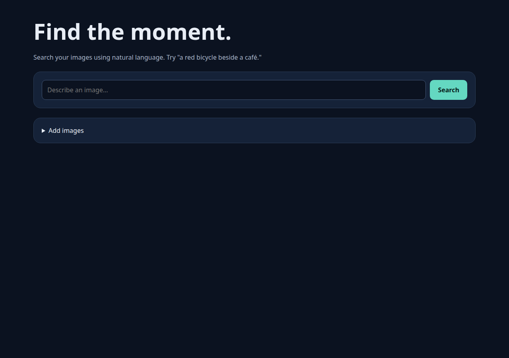

# TypeAndSee

Search photos with a description, such as **"a red bicycle beside a café"**.



*The browser interface for image upload, natural language search, and optional explanations.*


*CLIP creates image and text embeddings. Chroma searches locally; Firestore supports GCP deployment. Captions and metadata can support an optional generated explanation.*

```bash
uv sync --extra test
uv run uvicorn typeandsee.api:app --reload
```

Open [localhost:8000](http://localhost:8000). See the [setup and deployment guide](docs/guide.md) for imports, evaluation, tracing, and GCP configuration.
